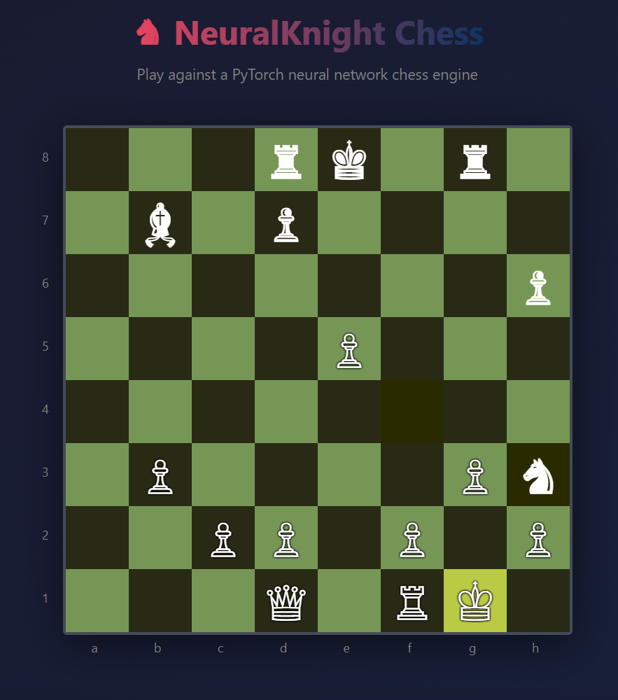

# NeuralKnight-Chess ♟️

A chess AI built with a convolutional neural network that learns move patterns from elite-level Lichess games.

##  Overview

This is a learning project exploring how neural networks can learn chess through supervised learning on game data. The model uses a basic CNN architecture to predict moves based on board positions, trained on games from high-rated Lichess players and synthetic data.

##  Architecture


### Training Setup
- **Loss Function**: Cross-Entropy Loss
- **Optimizer**: Adam (lr=0.0001)
- **Batch Size**: 64
- **Gradient Clipping**: Max norm 1.0

##  Project Structure

```
NeuralKnight-Chess/
├── data_preprocessing.py   # PGN → numpy conversion
├── torch_model.py          # CNN with residual blocks
├── train.py                # Training script
├── play_chess_gui.py       # GUI to play against AI
└── models/                 # Saved weights
```


##  Deployment

NeuralKnight is deployed online, so you can play against the engine in your browser with no installation needed:

**[Play NeuralKnight in your browser](https://ees4ykg.github.io/NeuralKnight-Chess/)**



##  Training Data

Currently trained on Lichess Elite database games (June 2021 - November 2022). The dataset contains games from high-rated players in PGN format.

To train on different data, modify the `limit_of_games` parameter in `data_preprocessing.py`.

##  How It Works

### Board Encoding
Each board position is represented as a 14×8×8 tensor:
```
Channels 0-5:   White pieces (P, N, B, R, Q, K)
Channels 6-11:  Black pieces (p, n, b, r, q, k)
Channel 12:     Legal move destinations
Channel 13:     Turn indicator (1=White, 0=Black)
```

### Move Selection
The model outputs probabilities for moves it has seen during training. At inference:
1. Model predicts probability distribution over all learned moves
2. Predictions are sorted by probability
3. First legal move from the sorted list is selected

This ensures the AI only makes valid moves according to chess rules.

##  Limitations

- Model only knows moves it has seen in training data
- No strategic planning or position evaluation
- Performance depends heavily on training data quality
- Can struggle with unusual positions or endgames
- Not competitive with traditional chess engines


*Note: This is an educational project demonstrating neural network applications in game AI. It is not intended to compete with traditional chess engines like Stockfish or AlphaZero, although maybe someday we will reach that level ;)*
